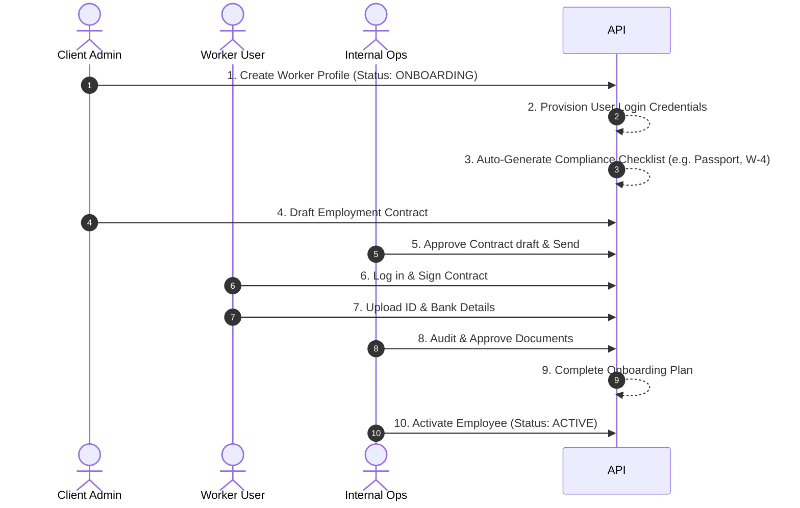

# Product Overview - GlobalWorkforce OS

GlobalWorkforce OS is a comprehensive multi-tenant Employer of Record (EOR) operations platform designed to orchestrate the lifecycle of international employment. EOR companies act as the legal employer on behalf of client corporations, managing payroll, statutory benefits, local taxation, and onboarding compliance across border lines.

---

## Target Audience & Roles

The system supports five operational profiles with strict boundaries:

1. **Platform Administrator (`PLATFORM_ADMIN`)**: High-privilege operators managing tenants, regional compliance rules, countries database, and full cross-tenant data access.
2. **Internal Operations (`INTERNAL_OPS`)**: Platform staff handling contract reviews, payroll locked period approvals, compliance document audits (Approving/Rejecting checklists), and support inquiries.
3. **Client Administrator (`CLIENT_ADMIN`)**: Corporate contacts representing client companies. They manage company profiles, list active workers inside their tenant, draft contracts, and file tickets.
4. **Client Human Resources (`CLIENT_HR`)**: HR managers representing client companies. They handle day-to-day employee updates, complete HR-assigned onboarding checklists, and query ticket threads.
5. **Worker (`WORKER`)**: Hired employees. They log in to execute tax checklist forms, sign their employment contracts, submit ID verifications, and explore payslip records.

---

## Core Operations Workflows

### 1. Unified Employee Onboarding Lifecycle
* **Initiation**: Corporate admins add a worker. The system automatically spawns their user profile, generates an `OnboardingPlan`, and matches their country code against preconfigured compliance requirements (such as HMRC checklist in UK or W-4 in USA) to generate tasks.
* **Agreement**: Contracts move from `DRAFT` to `IN_REVIEW`. Internal ops verifies regional salary minimums and approves them. Workers log in to sign the contract online, shifting status to `SIGNED`.
* **Verification**: Workers upload compliance documentation. Internal operations reviews each file, approving or rejecting with detailed reasons (e.g., blurry scanning).
* **Fulfillment**: The moment all onboarding checklists are checked off, the onboarding plan status shifts to `COMPLETED`.
* **Activation**: Client administrators can transition workers to `ACTIVE`. If they try to activate a worker *before* compliance onboarding is completed, the system blocks the transition unless an internal operations manager overrides the block with a validated operational reason logged in the audit logbook.

### 2. Multi-Currency Payroll Processing
* **Cycle Setup**: Cycle periods are initialized (Draft -> Collecting Inputs).
* **Auto-Generation**: The system automatically aggregates all active employees in that company and country, maps their local contracts, divides their monthly salary based on pay frequency, and inserts `PayrollItem` records.
* **Reconciliation**: Admins review items, approve individual payouts, append bonuses, or hold disputable lines.
* **Disbursement**: Funding is approved (Approved -> Paid) and individual paychecks are finalized.
* **Aggregation**: Consolidated dashboard widgets showcase cumulative cost aggregates grouped by currency (e.g. USD vs. GBP vs. EUR) to protect against FX exposures.
