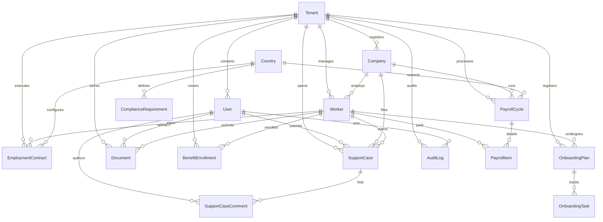

# Domain Model - GlobalWorkforce OS

GlobalWorkforce OS uses PostgreSQL managed by Prisma ORM. The schema is highly relational, utilizing strict constraints, foreign keys, and cascading rules to guarantee data integrity across all features.

---

## Entity Relationship Diagram

The domain model contains 16 relational entities:

---

## Core Entities Glossary

### 1. Multi-Tenant Context
* **Tenant**: The primary billing account separating workspaces (e.g., `ACME Corp` vs. `Stark Industries`). Every client record belongs to a tenant.
* **User**: Represents physical individuals. Contains names, hashed passwords, roles, and user statuses.

### 2. Employment Context
* **Company**: The client entity operating in a specific headquarters country.
* **Worker**: Profiles detailing names, department, start dates, and managers. Can be linked to a `User` account for logging in.
* **Country**: Static database of regional codes (e.g. US, GB, DE) detailing payroll frequencies and contract requirement rules.
* **ComplianceRequirement**: Regulatory mandates per country (e.g. passport checks or W-4 forms) used to generate onboarding tasks.
* **EmploymentContract**: The binding agreement detailing monthly compensation, currency code, and type (Full-time, contractor, etc.).

### 3. Onboarding & Verification
* **OnboardingPlan**: Main checklist overview tracking employee onboarding.
* **OnboardingTask**: Individual checklist tasks. Map requirement types and assign to roles (e.g. document uploads assigned to Worker).
* **Document**: Metadata tracks submitted files, statuses (Pending, Approved, Rejected), and rejection reasons.

### 4. Payroll & Welfare
* **PayrollCycle**: Grouping pay periods for an employer and country.
* **PayrollItem**: Individual paychecks detail gross earnings, currencies, and item status (Pending, Approved, Held, Paid).
* **BenefitEnrollment**: Tracks eligibility and enrollment in health, dental, or retirement benefits.

### 5. Support & Trace
* **SupportCase**: Support inquiries categorized by priority and department.
* **SupportCaseComment**: Conversation logs. Can be toggled `isInternal` to hide operational notes from clients.
* **AuditLog**: Unified operational logbook recording actor ID, actions, modified entities, and modified metadata.
